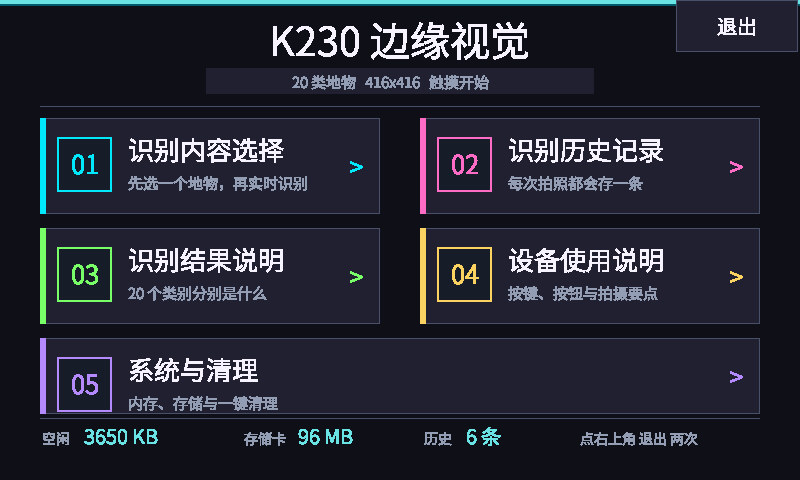
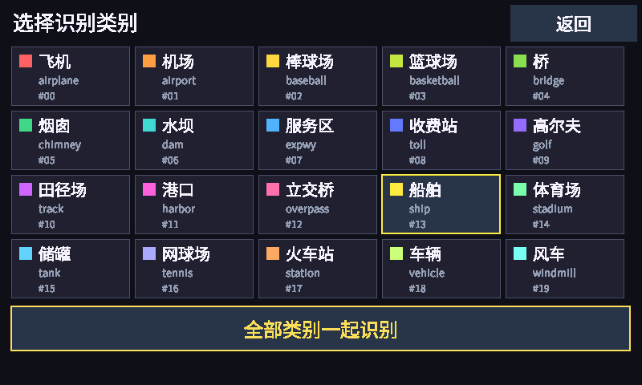
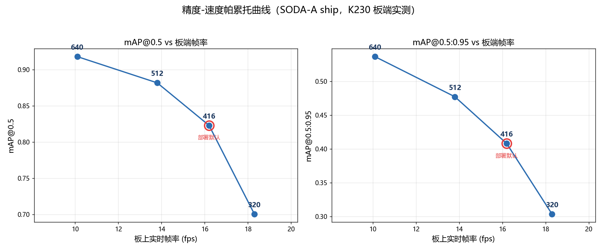
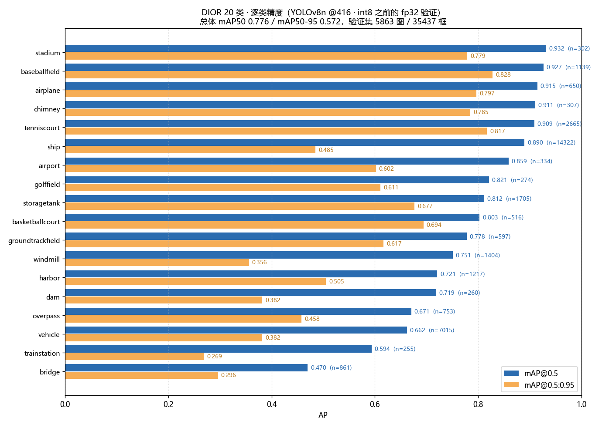

# K230 船舶检测：在 128 MB 的 RISC-V 边缘板上跑 YOLOv8n

> 庐山派 Lite-K230D（CanMV / MicroPython）+ 800×480 MIPI LCD，摄像头实时检测、按键拍照存 TF 卡、读图检测出 JSON。
> 从 DOTA 式旋转框数据一路做到 int8 kmodel，全程有量化、跨域、失败归因、拍屏端到端、帕累托与 20 类扩展的实测数字。

**English**: End-to-end ship detection on a Kendryte K230D (RISC-V, 128 MB RAM, CanMV MicroPython) with a 800×480 MIPI LCD. Includes dataset conversion (OBB→HBB), YOLOv8n training, nncase int8 quantization, a three-channel camera pipeline that can *both* detect and save clean photos, cross-domain and failure analysis, and a 20-class extension.

[](https://doi.org/10.5281/zenodo.23976727)　[](LICENSE)

> **关于本项目的开发方式**：本项目由作者选题、定方向、做验收与全部硬件实机操作；**绝大部分代码实现、训练/评测脚本、实验数据分析与文档撰写由 AI 编程助手 [DeepSeek Harness](https://github.com/deepseek-ai) 完成**（人在环：每一步由作者确认、跑错由作者发现并纠正）。项目里所有数字均为真机实测，包括对自己前期错误结论的推翻记录（见 [`docs/补充实验-失败分析与量化代价.md`](docs/补充实验-失败分析与量化代价.md)）。

---

## 先看口径（重要，读任何数字之前请先读这里）

这个项目里出现过好几个"精度"，它们**不是一回事**：

| 口径 | 数值 | 含义 |
|---|---|---|
| 同域 val · 电脑 float32 · 416 | mAP50 **0.823** | 训练数据的验证集，未量化（698 图 / 42,428 框） |
| 同域 val · 电脑 float32 · 512 | mAP50 **0.882** | 更大输入尺寸 |
| 同域 val · 电脑 float32 · 640 | mAP50 **0.918** | 精度上限，但板端只有 10 fps |
| **板端 kmodel · int8 · 416** | mAP50 **≈0.75** | 量化实测掉 6.4~7.0 点 |
| 跨数据集光学（DIOR） | mAP50 **0.890** | 没参与训练的光学影像（同模态跨数据集） |
| 跨模态 SAR（HRSID） | mAP50 **0.192** | 光学模型直接上 SAR，基本不可用 |
| 真实拍屏端到端 | P **0.915** / R **0.887** | 摄像头拍屏幕、单应性变换回屏幕坐标系、逐框匹配（板子静止时） |
| 多类别（DIOR 20 类）· float32 | mAP50 **0.776** | 单类 → 20 类，证明链路通用 |

一句话：**板子上真实可用的是 0.75 左右那一档；0.918 是电脑上 640 的 float32 成绩；换 SAR 就崩；摄像头拍屏幕实测召回 0.887，但前提是板子稳住（手抖就废）。**

## 效果展示

| 中文触摸主页（800×480 LCD） | 20 类地物选择 |
|---|---|
|  |  |

| 精度-速度帕累托（板端实测 fps） | 20 类逐类 AP50 |
|---|---|
|  |  |

> 触摸主页、识别历史（含逐框坐标）、结果说明、系统清理等 7 个页面全部为板端实时绘制，**开机即用、全程不需要电脑**。

## 能力边界（都是测出来的）

- **船在画面里小于 12 像素就不可靠**：12 px 召回 0.72、9 px 0.44、6 px 0.14、4 px 0.14（模拟降质曲线，`runs/capture_experiment.png`）。
- **按尺寸分桶 AP50（416 / 640）**：<8 px 0.023 / 0.208；8–16 px 0.695 / 0.878；16–32 px 0.870 / 0.935；>32 px 0.928 / 0.951。**640 的收益 90% 集中在 8–16 px 的小目标。**
- **密集场景与 `max_det`/`max_boxes_num`**：本数据集单图最多 668 个目标。训练侧 `max_det=300` 会把密集图截断（recall 0.814 → 改 1000 后 0.847）；板端 `MAX_BOXES_NUM=200` 同理需要按场景调。
- **量化代价**：int8 相对 fp32 掉 mAP50 6.4~7.0 点。换校准算法（Kld）只 +0.7 点、校准集翻倍只 +0.6 点 → **瓶颈是权重位宽本身，不是校准策略**，要回收只能上 QAT 或混合精度。
- **基线对照（同数据同设置）**：YOLOv5nu 0.808 / **YOLOv8n 0.823** / YOLO11n 0.834 / YOLOv8s 0.872。选 v8n 不是因为它最准，而是因为部署约束（128 MB、实时）。

## 板上实测性能

| 输入尺寸 | 帧率（有目标） | 单帧推理 | kmodel | mAP50 |
|---|---|---|---|---|
| 320 | 18.3 fps | 22 ms | 3.32 MB | 0.700 |
| 416 | 16.2 fps | 34 ms | 3.42 MB | 0.823 |
| **512**（推荐拐点） | 13.8 fps | 47 ms | 3.47 MB | **0.882** |
| 640 | 10.1 fps | 74 ms | 3.64 MB | 0.918 |

> 上面是统一口径的 bench 脚本（自建三通道、不用官方 PipeLine），主程序实测约 +3 fps（416 = 19.0、512 = 17、640 = 13.2）。
> 单帧耗时分解（512、71 框）：取流 0.9 / ai2d 预处理 2.1 / **KPU 40.9** / 后处理 3.6 / **画框 18.9** / 送显 4.9 ms。
> **画框是第二大开销，其中 16 ms 全花在逐框写标签文字上**（≈0.24 ms/框）——所以密集场景下跳过标签不是美观取舍，是实打实的 +20% 帧率。

## 为什么要三通道（本项目的核心工程决定）

官方 `PipeLine` 的两路输出（CH0 YUV420SP 送屏、CH2 RGBP888 送 AI）**都存不了图**：`Image.save()` 只支持 RGB565。想"边检测边存一张干净照片"就必须自己开第三条通道：

```
CH0  800×480 YUV420SP  →  Display.bind_layer(LAYER_VIDEO1)   只给屏幕，不过 CPU
CH1  800×480 RGB565    →  按键时 snapshot，存 JPEG（唯一能 save 的格式）
CH2  800×480 RGBP888   →  AI 输入（planar CHW）
```

三通道必须在 `sensor.run()` **之前**全部配置完，之后再配会 `snapshot chn(1) failed(3)`。多开这一路的代价接近于零（19.0 vs 18.4 fps）。

## 快速开始

### 1. 板子（离线自跑，摄像头 + 按键拍照）

TF 卡根目录放三个文件：

```
/sdcard/boot.py          4 行启动引导（见 board/boot_loader.py）
/sdcard/main.py          主程序（= board/k230_ship_detect_512.py，按你的模型改 KMODEL_PATH / MODEL_INPUT_SIZE）
/sdcard/best512.kmodel   int8 模型（3,634,856 B）
```

上电自动运行：屏幕出实时画面 → 左上角 fps 与目标数 → 短按 USR 存一张带框 JPEG → 长按 3 秒退出。
USR 键在 Lite 版是 **GPIO64**（下拉、按下为高），RGB 灯红 GPIO65 / 绿 GPIO66。

### 2. 触摸屏版：中文交互界面（推荐演示用）

`board/k230_touch_launcher2.py` → 存为 `/sdcard/main.py`，配 `/sdcard/dior20.kmodel`（20 类）即可。

上电直接进**触摸主页**（全程不用电脑）：

- **识别内容选择** → 20 类地物任选一类（或"全部"）→ 进实时画面只画该类
- **识别历史记录** → 每次拍照都存一条，可翻页 / 点开看**逐框坐标与迷你框位图**
- **识别结果说明** → 20 类的中英文名与一句话释义
- **设备使用说明** → 按键、拍照要点（12 px 目标下限等）
- **系统与清理** → 空闲内存 / 存储卡 / 一键 `gc.collect()`
- 检测页底部 `拍照` / `菜单`，右上角 `退出`（连点两次）

实现要点（别人踩过的坑我写在这里）：屏幕 800×480，触摸芯片是 **FT5x06 系挂在 I2C3 地址 0x38**（固件自带 `machine.TOUCH` 只支持 CST/GT911，读不到点，只能裸读 I2C 寄存器）；触摸原始坐标是面板竖屏坐标，需要按四点标定做旋转 + 缩放映射；屏上中文直接用 `draw_string_advanced` 的**内置 FreeType 字库**（自带常用汉字，不需要塞 TTF；但 `「」` 这类全角括号缺字）。

### 3. 读图检测（出逐框 JSON，不开摄像头）

```python
# 板上：/sdcard/img_detect.py，图片丢进 /sdcard/input/
# 输出：/sdcard/photo/DET_xxx.jpg（带框）+ DET_xxx.json（逐框坐标）
{"image_w": 800, "image_h": 800, "count": 118,
 "detections": [{"cls": 0, "conf": 0.853, "x": 637, "y": 438, "w": 38, "h": 28}, ...]}
```

### 4. 训练与量化（电脑侧）

```powershell
# 数据：OBB（9 字段）→ HBB（5 字段），本仓库实测 82,007 框零丢失
python tools\obb_to_hbb.py --src datasets\sodaa_ship --dst datasets\sodaa_ship_hbb

# 训练
yolo detect train model=yolov8n.pt data=datasets\sodaa_ship_hbb\data.yaml imgsz=416 epochs=100 batch=16

# 导出 + int8 量化（nncase 2.11，需先装 nncase + nncase_kpu 的 Windows wheel）
python tools\convert_kmodel.py --run runs\ship_416_v1 --calib calib --size 416 --nsamp 60 --calibrate NoClip
```

## 仓库结构

```
board/      板端程序（中文触摸主页、单类 512 生产版、416/640 版、读图版、20 类版、boot loader）
tools/      数据转换、量化、评测、绘图、串口传输等脚本（全部有 --help 或有注释说明参数）
figures/    实验图（帕累托曲线、耗时分解、置信度扫描、拍屏正交、跨域、逐类 AP、失败分析）
docs/       技术文档（实现全记录 / 21 条踩坑记录 / 补充实验：失败分析与量化代价）
models/     int8 kmodel（416 单类、512 单类、20 类）
```

## 已知局限（请不要误读这些数字）

1. **跨传感器未覆盖**：跨数据集（DIOR 光学）与跨模态（HRSID/SAR）都测了，但 Sentinel-2、GF-2 等其它光学传感器没有带标注的公开数据可测。
2. **拍屏实验没有夹具**：所有拍屏数据都是手扶 / 垫在杯子上按的，稳定对仍有 1–5 px 残余位移，把平均匹配 IoU 压到 0.799。有夹具后指标会更好，但不能与本仓库数字直接比较。
3. **光照维度未测量**：屏幕是自发光强光源 + 相机自动曝光漂移，"开灯/关灯"两组画面平均亮度只差 2.3、召回方向还相反，所以这一维在本项目里是**未测量**，不是"影响很小"。
4. **多类：桥最差（0.470）**：长条形目标（长宽比可达 10:1）用水平框表达会带大量背景，需要专门处理（分割/旋转框）。
5. **默认只跑单类船舶**：20 类模型已验证可上板（板端与 PC 逐框 100% 类别一致），但目前是第二种模式，不是默认。

## 数据来源（不随仓库分发）

- 训练/验证：**SODA-A ship**（ModelScope `lujiajun/sodaa_ship_yolo`，YOLO-OBB 格式，原图来自 DOTA 的 800×800 切片）——请遵守其原始许可。
- 跨域光学：**DIOR**（ModelScope `AIMGroup/DIOR`，20 类遥感目标检测）。
- 跨模态：**HRSID**（ModelScope `markyu1999/HRSID_subset260606`，SAR 舰船）。

数据集**不包含**在本仓库中，请按上面的 ID 自行下载并遵守原始许可。

## 许可

代码：MIT（见 `LICENSE`）。模型权重：随仓库以 MIT 分发，但**训练数据（SODA-A / DOTA / DIOR / HRSID）各有自己的许可**，商用前请自行核对。

## 引用

如果本项目的代码、模型或实验结论对你的工作有帮助，可以这样引用（任何版本都用**概念 DOI**，它会自动指向最新版）：

```bibtex
@software{guo_k230_ship_detector_2026,
  author    = {郭, 力玮},
  title     = {K230 边缘端遥感地物检测与中文触摸交互系统},
  year      = {2026},
  publisher = {Zenodo},
  version   = {v1.0.2},
  doi       = {10.5281/zenodo.23976727},
  url       = {https://github.com/XiaoFenglistens/k230-ship-detector}
}
```

- 概念 DOI（永远指向最新版）：[10.5281/zenodo.23976727](https://doi.org/10.5281/zenodo.23976727)
- 本版本 DOI（固定指 v1.0.2）：[10.5281/zenodo.23976728](https://zenodo.org/records/23976728)
- 归档快照：[https://zenodo.org/records/23976728](https://zenodo.org/records/23976728)

## 致谢

Kendryte CanMV 固件与 nncase 工具链；Ultralytics YOLOv8；DOTA / SODA-A / DIOR / HRSID 数据集的作者。

**本项目大部分工作由 AI 编程助手 [DeepSeek Harness](https://github.com/deepseek-ai) 完成**：代码实现、训练与评测脚本、实验数据分析、文档撰写均由它产出，作者负责选题、方向决策、真机操作与结果验收。特此说明。

## 关于脚本里的路径

`tools/` 下的脚本是为本机布局写的，每个文件开头都有一段常量（例如 `ROOT = r'D:\rs-yolo'`、`RUN = r'D:\rs-yolo\runs\ship_416_v1'`），**改这一段就能在自己机器上跑**；有 `argparse` 的脚本（`convert_kmodel.py`、`quant_gap.py`、`failure_analysis.py`、`conf_sweep.py`、`eval_crossdomain.py`、`dior_to_yolo.py`、`pareto_board.py`、`capture_experiment.py`）直接用参数覆盖。

## 相关文章

`docs/文章-K230部署踩坑21条.md`：把上面这些坑按「环境 / 数据 / 量化 / 显示存图 / 坐标预处理 / 内存串口 / 性能」分类写成了故障目录，每条都有现象、根因、判据和解法。

## 依赖与第三方许可

- **Ultralytics YOLOv8**：用于训练与导出，许可证是 **AGPL-3.0**。本仓库**不包含** ultralytics 的源码，只包含自己写的板端部署代码、训练产物（.pt / .onnx / .kmodel）与评测结果。商用请遵守 AGPL-3.0 或购买 Ultralytics 商业授权。
- **nncase / nncase-kpu**（嘉楠 Kendryte）：Apache-2.0，用于把 ONNX 编译成 K230 可执行的 kmodel。
- **CanMV 固件**（嘉楠 Kendryte）：板端 MicroPython 运行时。`libs/` 下的 `AIBase` / `YOLO` / `AI2D` / `PipeLine` 由固件提供，**不在本仓库内**。
- **数据集**：SODA-A / DOTA / DIOR / HRSID 各有自己的许可，本仓库不分发数据。
